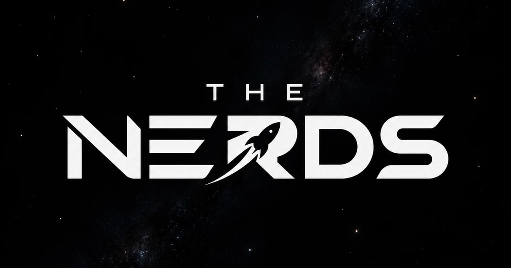
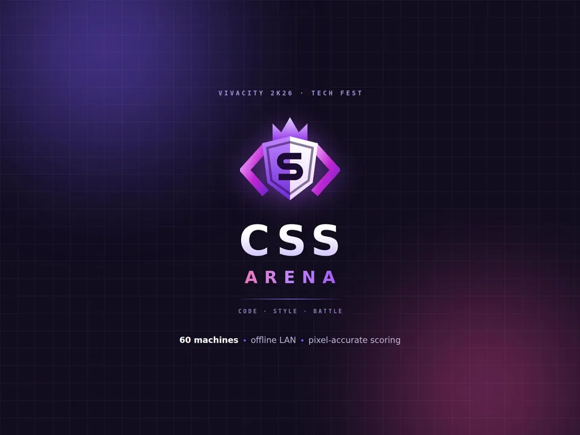
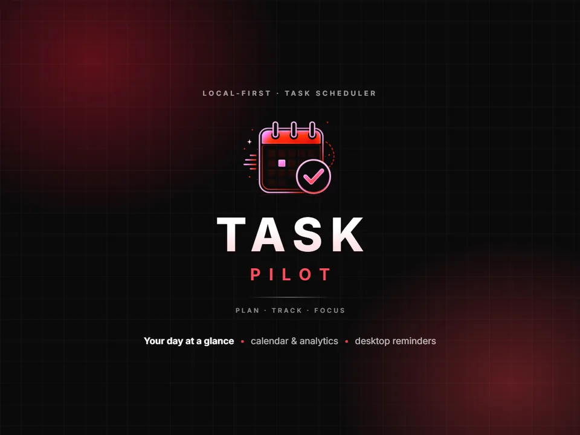
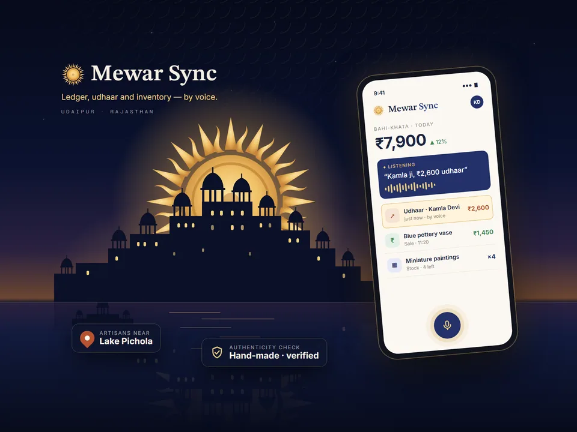
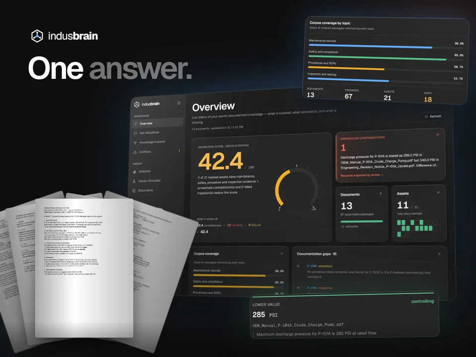

  

<h3 align="center">Creative Development Studio · Surat, India</h3>

  Blending <b>creativity</b> and <b>technology</b> to build experiences that feel genuinely different.

  <a href="https://www.thenerds.dev"><b>thenerds.dev</b></a> ·
  <a href="https://www.thenerds.dev/work/">Our work</a> ·
  <a href="https://www.thenerds.dev/info/">About us</a> ·
  <a href="https://www.thenerds.dev/contact/">Contact</a>

---

## Hi, we're The Nerds

We're **Meet Raval** and **Prem Kajiwala**, two devs from Surat, India, who love cooking up cool stuff for the web. From slick websites to custom software and crazy useful automations, we build things that just work.

No corporate BS, no middlemen. Just two nerds turning your ideas into something awesome. If you can dream it up, we'll happily nerd out building it.

| | |
|---|---|
| **Based in** | Surat, India, working remotely |
| **Response time** | Within 24 hours |
| **Email** | [getintouch@thenerds.dev](mailto:getintouch@thenerds.dev) |

---

## Why we built this site

[thenerds.dev](https://www.thenerds.dev) is our home on the web: one place to show who we are, what we've built, and how we like to build it.

We didn't want it to look like every other template site, so the site itself is part of our work:

- a night sky drawn live in WebGL;
- neon portraits of the two of us, circled by space rocks you can throw at each other;
- a shower of tiny planets with real physics;
- pages that change without ever reloading.

If it makes you curious about what we could build for you, it has done its job.

---

## What we offer

- Consultation
- UI/UX Design
- Full Stack Development
- AI Solutions
- Social Media Management
- Search Engine Optimization (SEO)
- Business Automation
- Motion Graphics & Video

## What we build

| | |
|---|---|
| **Digital Platforms** Websites, digital products, and online experiences. | Marketing Websites & Landing Pages · E-commerce Stores · Web Applications & Portals · Content Management Systems (CMS) |
| **Intelligent Products** AI-powered tools and connected digital systems. | AI-Powered Applications · AI Chatbots & Virtual Assistants · Custom Business Tools · API Integrations |
| **Digital Performance** Digital assets and measurement systems that support online growth. | SEO-Ready Website Structures · Conversion-Focused Landing Pages · Analytics Dashboards · Performance Reports |
| **Visual Content** Visual assets created for brands, campaigns, and digital platforms. | Motion Graphics & Animations · Promotional Videos · Social Media Creatives · Digital Brand Assets |
| **Business Systems** Practical systems that improve business operations. | Automated Workflows · Admin Panels & Dashboards · Lead Management Systems · Reporting & Integration Pipelines |

---

## Things we built lately

> Heavy on ideas. Light on boring. We turn wild ideas into websites, clever software, and digital experiences worth showing off.

### CSS Arena · 2026

A CSS battle platform built for the Vivacity 2K26 tech fest. Contestants recreate a target design in HTML and CSS against the clock, and every attempt is scored pixel by pixel, across more than 60 machines on an offline LAN.

[Case study](https://www.thenerds.dev/work/css-arena/) · [Code on GitHub](https://github.com/meetRaval09/css-arena)

### TaskPilot · 2026

A local-first task scheduler for planning the day, tracking what got done and staying focused. It has:

- a dashboard with your day at a glance;
- a month calendar;
- analytics on streaks and trends;
- desktop reminders;
- themes from dark to sandstone.

[Case study](https://www.thenerds.dev/work/taskpilot/) · [Code on GitHub](https://github.com/premkajiwala-hub/Task-Pilot)

### Mewar Sync · 2026

An AI-powered platform for traditional artisans, helping preserve India's rich cultural heritage. It brings them:

- voice-based accounting;
- smart inventory management;
- financial tracking;
- other digital tools.

[Case study](https://www.thenerds.dev/work/mewar-sync/) · [Code on GitHub](https://github.com/premkajiwala-hub/Mewar_Sync)

### Indus Brain · 2026

An AI-powered knowledge platform for industrial plants. It reads manuals, logs and standards, builds a knowledge graph, and answers engineering questions with cited evidence. Where documents contradict each other, it flags them instead of guessing. It runs fully on your own machine.

[Case study](https://www.thenerds.dev/work/indus-brain/) · [Code on GitHub](https://github.com/indusbrain/indusbrain)

---

## What's on the site

| Page | What you'll find |
|---|---|
| [**Home**](https://www.thenerds.dev/) | See the four parts below |
| [**Work**](https://www.thenerds.dev/work/) | Every project in one scrolling stack of cards |
| **Case studies** | One page per project: what it is, its video or screenshots, the year, and a link to its code |
| [**About**](https://www.thenerds.dev/info/) | A little about us, what we offer, and what we build |
| [**Contact**](https://www.thenerds.dev/contact/) | Tell us your idea in a short form. You'll hear back within 24 hours. |

The home page, top to bottom:

1. **Welcome.** Neon portraits of the two of us, with space rocks circling them. Tap a rock and one of us throws it at the other.
2. **About.** Scroll down and the rocks spiral in, collide and shatter, and the two of us say hello.
3. **Things we built lately.** A reel of our latest projects.
4. **Got a big idea?** A shower of tiny planets falls into the last screen: Jupiter, Saturn, Earth and the rest, each with its real tilt and spin. Push them around, then get in touch.

## Built with

- [Vite](https://vitejs.dev)
- [three.js](https://threejs.org) (WebGL)
- [GSAP](https://gsap.com)
- [Lenis](https://lenis.darkroom.engineering)
- Our own CMS for the projects and content
- [Supabase](https://supabase.com) and [Resend](https://resend.com) behind the contact form
- [Cloudflare](https://www.cloudflare.com) for hosting

The site works on phones, tablets and desktops. Without WebGL, or with reduced motion turned on, it falls back to a plain, fully readable page.

Planet textures are from [Solar System Scope](https://www.solarsystemscope.com/textures) (CC BY 4.0).

Working on the site itself? See the [developer guide](DEVELOPMENT.md), the [CMS guide](cms/README.md) and the [contact form setup](supabase/README.md).

---

## Got a big idea?

Big, small, or somewhere in between. Let's build something worth talking about.

- **Email:** [getintouch@thenerds.dev](mailto:getintouch@thenerds.dev)
- **Socials:** [Instagram](https://www.instagram.com/thenerds.dev/) · [LinkedIn](https://www.linkedin.com/company/145305179/)

  <a href="https://www.thenerds.dev"><b>Visit us at www.thenerds.dev</b></a>

© 2026 The Nerds

